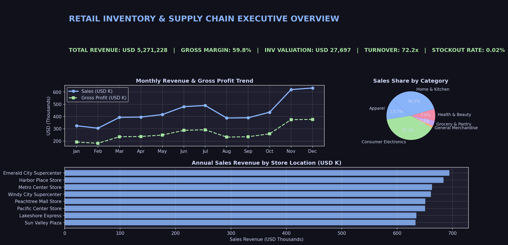
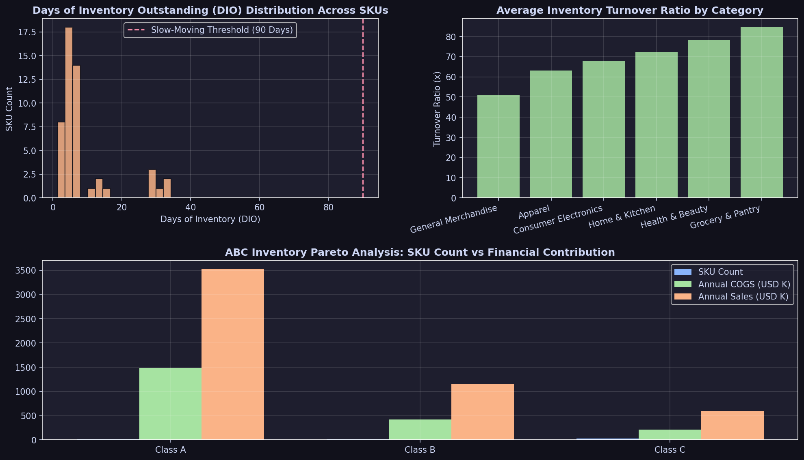
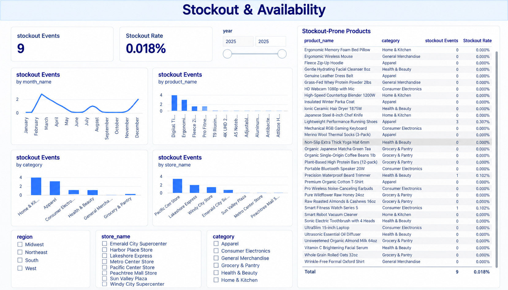
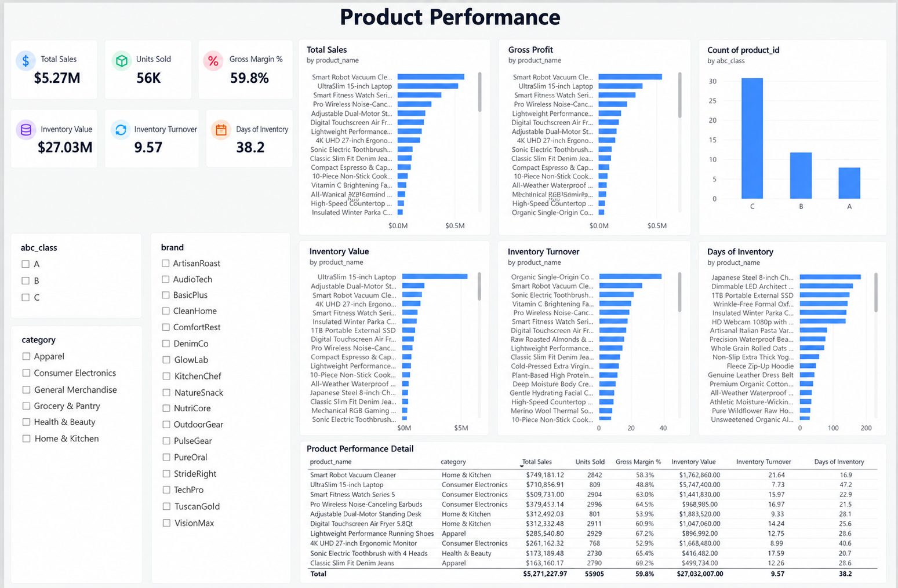
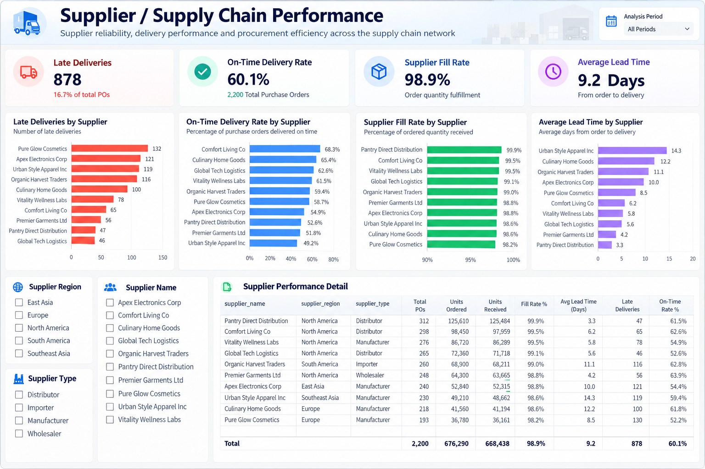
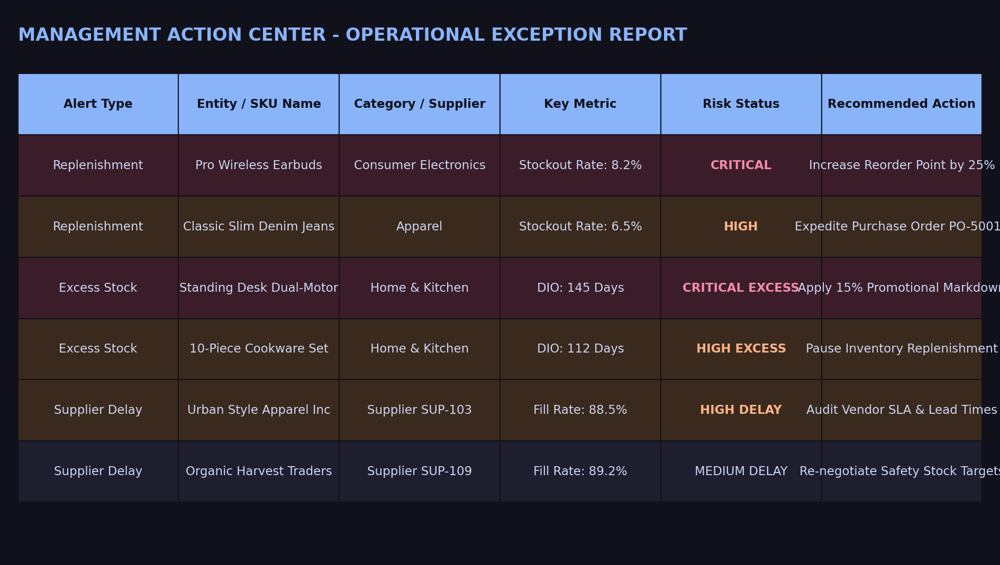

# Retail Inventory & Supply Chain Performance Analysis

**SQL • Python • Pandas • SQLite • Power BI • DAX**

An end-to-end portfolio project analyzing retail sales, inventory efficiency, stockouts, product performance, and supplier operations across a multi-store retail environment.

The project demonstrates the complete analytical workflow:

```text
Synthetic Data
      ↓
Data Quality Audit
      ↓
Data Cleaning & Feature Engineering
      ↓
SQLite Star Schema
      ↓
SQL & Python Analytics
      ↓
Power BI Data Model & DAX
      ↓
Interactive Dashboard
      ↓
Business Insights & Management Actions
```

---

## Executive Overview

This project analyzes a realistic synthetic retail dataset covering:

- **34,565 sales transactions**
- **48,800 daily inventory snapshots**
- **2,200 purchase orders**
- **50 product SKUs**
- **8 retail stores**
- **10 suppliers**
- **12 months of operational data**

The objective is to understand how effectively a retail business manages inventory while maintaining product availability and supplier performance.

The analysis focuses on:

- Sales and profitability
- Inventory valuation
- Inventory turnover
- Days of Inventory (DIO)
- Stockout events
- Slow-moving and excess inventory
- ABC product classification
- Supplier fill rates
- Supplier on-time delivery
- Lead times
- Replenishment signals
- Operational risk

### Current Dashboard KPIs

The Power BI report provides an executive view of the current dataset, including:

| KPI | Dashboard Value |
|---|---:|
| Total Sales | **$5.27M** |
| Units Sold | **56K** |
| Gross Profit | **$3.15M** |
| Gross Margin | **59.8%** |
| Inventory Value | **$27.03M** |
| Inventory Units | **734K** |
| Inventory Turnover | **9.57x** |
| Days of Inventory | **38.2 days** |
| MoM Sales Growth | **13.6%** |
| Stockout Rate | **0.018%** |
| Supplier Fill Rate | **98.9%** |
| On-Time Delivery Rate | **60.1%** |
| Average Lead Time | **9.2 days** |

> Values above represent the current Power BI report and may change if the synthetic dataset is regenerated.

---

# Dashboard

The Power BI report contains six analytical pages designed to move from executive-level performance to detailed operational actions.

## 1. Executive Overview

Provides a high-level view of sales, profitability, inventory, stockouts, and supplier performance.



---

## 2. Inventory Performance

Analyzes inventory value, inventory turnover, Days of Inventory, stock levels, inventory trends, and category/store performance.



---

## 3. Stockout & Availability

Examines stockout events across products, categories, stores, and time periods, with a detailed stockout-prone product table.



---

## 4. Product Performance

Connects sales, profitability, inventory value, inventory turnover, Days of Inventory, and ABC classification at the product level.



---

## 5. Supplier / Supply Chain Performance

Evaluates supplier delivery reliability using late deliveries, on-time delivery rate, fill rate, and average lead time.



---

## 6. Management Action Center

Transforms analytical outputs into operational exception lists covering replenishment, excess inventory, and supplier attention.



---

# Business Problem

A multi-store retail business needs to balance product availability against the cost and risk of holding inventory.

The project addresses the following operational questions:

1. **Sales Drivers** — Which products and categories drive revenue and gross profit?
2. **Stockouts** — Which SKUs and stores experience out-of-stock events?
3. **Excess Inventory** — Where is inventory holding too high relative to sales velocity?
4. **Slow-Movers** — Which products have high Days of Inventory?
5. **Store Efficiency** — How does inventory efficiency vary across stores?
6. **Inventory Conversion** — How effectively is inventory converted into sales?
7. **Demand Patterns** — What monthly and weekly sales patterns are visible?
8. **Replenishment Signals** — Which products require additional inventory attention?
9. **Inventory Risk** — Which products represent potential excess-stock exposure?
10. **Supplier Performance** — Which suppliers have delivery or lead-time issues?

---

# Tech Stack

| Domain | Tool / Technology | Usage |
|---|---|---|
| Programming | Python 3.11 | Data generation, cleaning, feature engineering, validation |
| Data Analysis | Pandas, NumPy | Transformation, analysis, KPI calculations |
| Database | SQLite | Relational analytical database |
| SQL | SQLite SQL | Analytical queries, CTEs, window functions, aggregations |
| Business Intelligence | Power BI | Interactive dashboard and data visualization |
| BI Calculations | DAX | KPI measures and business logic |
| Data Transformation | Power Query | Power BI data preparation |
| Visualization | Matplotlib, Seaborn | Supporting analytical visualizations |
| Documentation | Markdown | Methodology, data quality, business insights |

---

# Data Architecture

The project uses a relational **star-schema design** for analytical querying and Power BI reporting.

```text
                         dim_date
                            │
                            │
        dim_product ────────┼──────── dim_store
             │              │              │
             │              │              │
             ▼              ▼              ▼
        fact_sales     fact_inventory   fact_purchase
                            │
                            │
                     dim_supplier
```

## Fact Tables

### `fact_sales`

Transaction-level sales information including:

- Date
- Product
- Store
- Customer
- Quantity
- Selling price
- Discount
- Revenue
- Cost
- Gross profit

### `fact_inventory`

Daily product/store inventory snapshots including:

- Opening stock
- Received quantity
- Sold quantity
- Closing stock
- Inventory value
- Stockout flag
- Excess inventory flag

### `fact_purchase`

Supplier purchase-order information including:

- Ordered quantity
- Received quantity
- Expected delivery date
- Actual delivery date
- Lead time
- Supplier information

## Dimension Tables

### `dim_product`

Product catalog containing:

- Product ID
- Product name
- Category
- Subcategory
- Brand
- Unit cost
- Selling price

### `dim_store`

Retail store information containing:

- Store ID
- Store name
- City
- State
- Region
- Store type

### `dim_supplier`

Supplier information containing:

- Supplier ID
- Supplier name
- Supplier region
- Supplier type

### `dim_date`

Date dimension containing:

- Date
- Date ID
- Month
- Quarter
- Year
- Week
- Weekday
- Weekend indicator

---

# Data Quality & Cleaning

Before analytical processing, the project performs an automated data-quality audit.

The cleaning workflow checks for:

| Data Quality Check | Treatment |
|---|---|
| Duplicate sales records | Identify and deduplicate records |
| Missing store IDs | Identify and handle unassigned records |
| Date inconsistencies | Standardize dates and date IDs |
| Invalid quantities/prices | Identify and remove invalid records |
| Missing product categories | Apply defined category-imputation logic |
| Referential integrity | Validate relationships between facts and dimensions |

The detailed audit is documented in:

[`reports/data_quality_report.md`](reports/data_quality_report.md)

The main cleaning pipeline is:

[`src/data_cleaning.py`](src/data_cleaning.py)

---

# Feature Engineering

Operational inventory features are calculated using Python/Pandas.

Key engineered metrics include:

### Inventory Turnover

```text
Inventory Turnover =
Annualized COGS / Average Inventory Value
```

### Days of Inventory

```text
DIO =
(Average Inventory Value / Annualized COGS) × 365
```

### Safety Stock

Safety stock is calculated using a 95% service-level assumption with:

```text
Z = 1.65
```

The methodology incorporates demand variability and lead-time variability.

### Reorder Point

```text
ROP =
Average Daily Demand × Average Lead Time + Safety Stock
```

### Other Features

- Sell-through rate
- Supplier fill rate
- On-time delivery rate
- Slow-moving flag
- Excess-inventory flag
- Stockout flag
- ABC classification
- Inventory risk indicators
- Replenishment attention indicators

Detailed formulas and assumptions are documented in:

[`reports/methodology.md`](reports/methodology.md)

---

# SQL Analytics

The project contains **20 analytical SQL queries** organized into six thematic modules.

## 01 — Sales Analysis

[`sql/01_sales_analysis.sql`](sql/01_sales_analysis.sql)

Includes:

- Sales overview
- Category performance
- Store performance
- Month-over-month growth
- `LAG()` analysis
- Top and bottom products
- Seven-day rolling averages

## 02 — Inventory Analysis

[`sql/02_inventory_analysis.sql`](sql/02_inventory_analysis.sql)

Includes:

- Inventory valuation
- Inventory turnover
- Days of Inventory
- Category-level inventory analysis
- Store-level inventory analysis

## 03 — Stockout Analysis

[`sql/03_stockout_analysis.sql`](sql/03_stockout_analysis.sql)

Includes:

- Stockout events
- Stockout rate
- Stockout-prone products
- Lost-sales opportunity analysis

## 04 — Product Analysis

[`sql/04_product_analysis.sql`](sql/04_product_analysis.sql)

Includes:

- ABC/Pareto classification
- Slow-moving products
- Excess-inventory analysis
- Product-level inventory efficiency

## 05 — Supplier Analysis

[`sql/05_supplier_analysis.sql`](sql/05_supplier_analysis.sql)

Includes:

- Supplier fill rate
- On-time delivery rate
- Lead-time analysis
- Delivery delays

## 06 — Advanced Analysis

[`sql/06_advanced_analysis.sql`](sql/06_advanced_analysis.sql)

Includes:

- Composite inventory risk scoring
- Store inventory efficiency matrix

---

# Power BI Implementation

The Power BI report contains:

- A relational analytical model
- Star-schema relationships
- 25+ DAX measures
- Power Query transformations
- Six interactive dashboard pages
- KPI cards
- Trend analysis
- Category and store comparisons
- Product-level analysis
- Supplier-level analysis
- Operational exception tables
- Interactive slicers

### Power BI Assets

[`powerbi/retail_inventory_dashboard.pbix`](powerbi/retail_inventory_dashboard.pbix)

[`powerbi/dax_measures.dax`](powerbi/dax_measures.dax)

[`powerbi/power_query_transforms.m`](powerbi/power_query_transforms.m)

The `.pbix` file contains the complete Power BI report and model.

---

# Business Insights

The analysis is structured around:

```text
Finding
   ↓
Evidence
   ↓
Business Impact
   ↓
Recommendation
```

Key areas of attention identified through the analysis include:

### Inventory Efficiency

Products with relatively high Days of Inventory can tie up working capital and require review against sales velocity.

### Stockout Risk

Products and stores with repeated stockout events can be investigated for demand variability, safety-stock settings, and replenishment timing.

### Product Segmentation

ABC classification helps distinguish high-value/high-contribution products from lower-priority SKUs for inventory planning.

### Supplier Reliability

Supplier performance can be evaluated using:

- Fill rate
- On-time delivery
- Late deliveries
- Average lead time

### Replenishment

Products flagged by the management action center can be reviewed before issuing additional purchase orders, particularly when existing inventory is already high.

Detailed findings are available in:

[`reports/business_insights.md`](reports/business_insights.md)

---

# Analytical Recommendations

The analysis supports several operational areas for management review:

1. **Review safety-stock parameters** for high-demand products with stockout exposure.
2. **Evaluate excess inventory** using Days of Inventory and sales velocity before placing additional purchase orders.
3. **Prioritize supplier performance reviews** for vendors with weaker delivery reliability or longer lead times.
4. **Consider inter-store inventory balancing** where one location has excess stock while another location has stronger demand.
5. **Use ABC classification** to prioritize inventory planning effort toward higher-value products.
6. **Monitor replenishment signals** through product-level demand and inventory indicators.

These recommendations are intended as analytical decision-support actions rather than guaranteed financial outcomes.

---

# Project Structure

```text
retail-inventory-supply-chain-analysis/
│
├── README.md
├── requirements.txt
├── .gitignore
│
├── data/
│   ├── processed/
│   ├── data_dictionary.csv
│   └── retail_inventory.db
│
├── notebooks/
│   ├── 01_data_quality.ipynb
│   ├── 02_data_cleaning.ipynb
│   ├── 03_eda.ipynb
│   ├── 04_inventory_analysis.ipynb
│   └── 05_supply_chain_analysis.ipynb
│
├── powerbi/
│   ├── retail_inventory_dashboard.pbix
│   ├── dax_measures.dax
│   └── power_query_transforms.m
│
├── reports/
│   ├── business_insights.md
│   ├── data_quality_report.md
│   └── methodology.md
│
├── screenshots/
│   ├── executive_overview.png
│   ├── inventory_performance.png
│   ├── stockout_analysis.png
│   ├── product_performance.png
│   ├── supplier_performance.png
│   └── management_action_center.png
│
├── sql/
│   ├── 01_sales_analysis.sql
│   ├── 02_inventory_analysis.sql
│   ├── 03_stockout_analysis.sql
│   ├── 04_product_analysis.sql
│   ├── 05_supplier_analysis.sql
│   └── 06_advanced_analysis.sql
│
└── src/
    ├── data_cleaning.py
    ├── db_builder.py
    ├── feature_engineering.py
    ├── generate_synthetic_data.py
    ├── generate_visuals.py
    └── test_sql.py
```

---

# How to Reproduce the Analytical Pipeline

## Prerequisites

- Python 3.10+
- SQLite 3
- Power BI Desktop for opening/editing the `.pbix` report

## 1. Clone the Repository

```bash
git clone <your-github-repository-url>
cd retail-inventory-supply-chain-analysis
```

## 2. Install Python Dependencies

```bash
pip install -r requirements.txt
```

## 3. Generate the Synthetic Dataset

```bash
python src/generate_synthetic_data.py
```

This generates the synthetic retail sales, inventory, purchase-order, product, store, supplier, and date data used by the project.

## 4. Run the Data Quality and Cleaning Pipeline

```bash
python src/data_cleaning.py
```

## 5. Run Feature Engineering

```bash
python src/feature_engineering.py
```

## 6. Build the SQLite Database

```bash
python src/db_builder.py
```

The resulting analytical database is:

```text
data/retail_inventory.db
```

## 7. Validate the SQL Analysis

```bash
python src/test_sql.py
```

## 8. Explore the Jupyter Notebooks

The notebooks provide modular exploration of:

- Data quality
- Data cleaning
- Exploratory analysis
- Inventory performance
- Supply-chain performance

## 9. Open the Power BI Report

Open:

```text
powerbi/retail_inventory_dashboard.pbix
```

The included report contains the complete six-page Power BI dashboard.

> The Power BI report may require updating its data-source path when opened on another machine, depending on the local environment.

---

# Dataset Notes

This project uses **synthetically generated retail data** designed to resemble a realistic multi-store retail operation.

The synthetic dataset intentionally contains operational patterns and data-quality issues suitable for demonstrating:

- Data cleaning
- Relational modeling
- SQL analytics
- Inventory analysis
- Supply-chain analysis
- Business intelligence
- Operational decision support

The project is therefore intended for **portfolio and educational purposes**, not for representing real company performance.

---

# Limitations

Because the dataset is synthetic:

- Business patterns are simulated rather than observed from a real retailer.
- Supplier performance represents modeled operational behavior.
- Stockout and lost-sales estimates depend on the assumptions defined in the methodology.
- Inventory recommendations should be treated as analytical scenarios rather than actual procurement instructions.
- Results may change if the synthetic dataset is regenerated.

---

# Skills Demonstrated

This project demonstrates practical experience with:

### Data Analytics

- Exploratory data analysis
- KPI development
- Trend analysis
- Inventory analysis
- Supply-chain analysis
- Business insight generation

### SQL

- CTEs
- Window functions
- `LAG()`
- Rolling averages
- Aggregations
- Ranking
- Pareto/ABC analysis
- Multi-table joins

### Python

- Pandas
- NumPy
- Data cleaning
- Feature engineering
- Synthetic data generation
- Analytical validation

### Data Modeling

- Relational database design
- Star schema
- Fact and dimension tables
- Primary and foreign keys
- Analytical indexing

### Power BI

- Data modeling
- Power Query
- DAX
- KPI design
- Interactive dashboards
- Slicers and filtering
- Operational exception reporting

### Business Analysis

- Inventory optimization
- Stockout analysis
- Supplier performance
- Product segmentation
- Replenishment analysis
- Business recommendations

---

# Project Documentation

Additional project documentation:

- [`reports/data_quality_report.md`](reports/data_quality_report.md) — Data-quality audit
- [`reports/methodology.md`](reports/methodology.md) — KPI definitions and analytical methodology
- [`reports/business_insights.md`](reports/business_insights.md) — Findings, evidence, impact, and recommendations
- [`data/data_dictionary.csv`](data/data_dictionary.csv) — Dataset and field definitions

---

# Author

**Personal Data Analytics Portfolio Project**

Built to demonstrate an end-to-end Data Analyst workflow using **SQL, Python, Pandas, SQLite, and Power BI**.

---# retail-inventory-supply-chain-analysis
